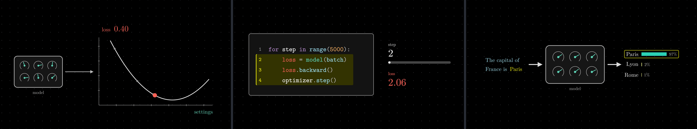
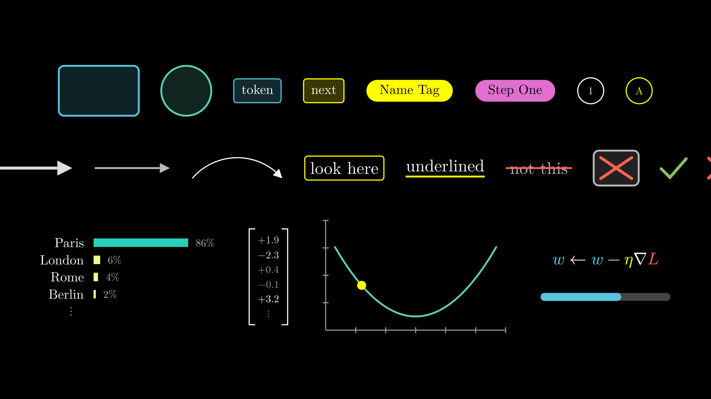
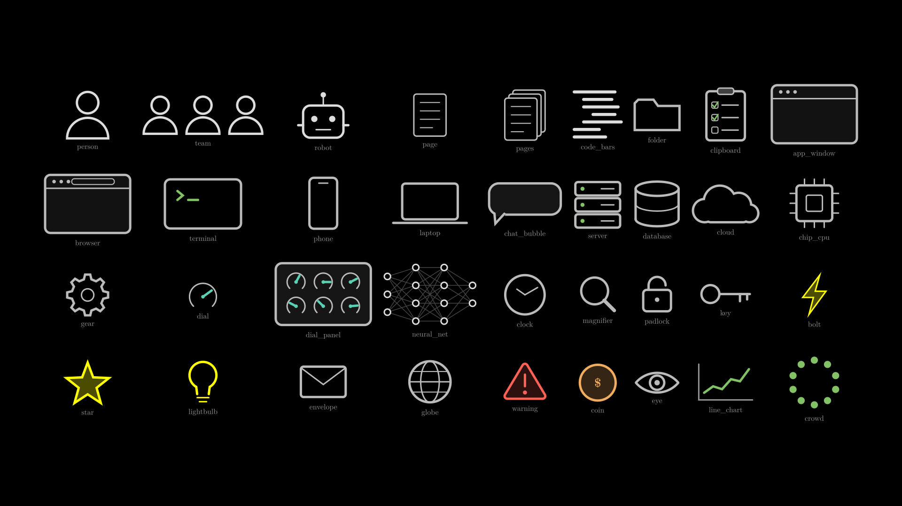

# x-animation

A two-engine motion studio for narrated explainer videos in the 3Blue1Brown tradition. Paste a
portion of a script; get back a verified 4K video whose pictures land on the spoken words.

- **[Manim Community](https://github.com/ManimCommunity/manim)** draws what *transforms*: diagrams
  that morph, math, plots, models, signals moving through a system.
- **[Remotion](https://www.remotion.dev)** draws what is *laid out*: code in an editor, product
  windows, tables, readouts, paragraphs.
- One style file and one clock per section drive both, so a cut from one engine to the other shows
  the same colours, the same type and the same stage, on the same frame.



*The reference section, `videos/demo/01-training`: 23 seconds, three segments, two engines.
Left and right are Manim, the editor in the middle is Remotion.*

## Quick start

Needs macOS or Linux, [uv](https://docs.astral.sh/uv/), Node 22 or newer and ffmpeg.

```bash
./x setup                        # Python + Manim, Node + Remotion, the headless browser, backdrops
./x draft demo/01-training       # the reference section at 960x540, a few seconds
./x final demo/01-training       # the 3840x2160, 60 fps master: about a minute on an M4
```

Output lands in `renders/<video>/`, with a storyboard and a cue sheet in `renders/<video>/qa/`.

## How a section is made

```
script ──▶ beats.json ──▶ pictures + engines ──▶ scene.py / Component.tsx ──▶ draft ──▶ final
```

1. `./x new "Title" --script pasted.txt` saves the script, splits it into beats and estimates when
   every word is spoken.
2. Each beat gets a picture, and each run of beats an engine, in `beats.json`.
3. Scenes and components are written against beats and words, never seconds:

   ```python
   class Learn(Segment):                      # Manim
       def construct(self):
           self.beat("Noise")                 # starts on its cue
           ...
           self.on("noise")                   # holds until the word is spoken
           self.play(turn_dials(model.dials, RANDOM))
   ```

   ```tsx
   const { t, cue, word } = useTimeline();    // Remotion
   const typing = ramp(t, word("Code", "code"), 0.4);
   ```

4. `./x draft` renders every segment in its own engine, joins them, and reports anything late,
   overlapping or still for too long. `./x final` renders the master and verifies it.
5. When the voiceover is recorded, `./x align <section> voiceover.wav` measures every word and the
   same code plays against the real voice.

The whole procedure: [`docs/WORKFLOW.md`](docs/WORKFLOW.md). Which engine for what:
[`docs/ENGINE_ROUTING.md`](docs/ENGINE_ROUTING.md).

## What keeps it honest

| Check | What it guards | When |
|---|---|---|
| Cue timing | Every beat and word-locked move starts on time; segments are exact to the frame | every Manim render |
| Overlap audit | No two objects touch or cross, even in the middle of a move | every tenth of a second of every Manim animation |
| Layout check | Nothing leaves the safe area | `check_layout()` in scenes |
| Stillness check | Nothing sits unchanged for more than 2.5 s | every render |
| Verification | Resolution, frame rate, exact frame count, codec, colour tags | every render |
| `./x parity` | The two engines draw the same colours, type, strokes and backdrop | after changing the style or an engine |
| `./x contrast` | Every colour can be read on every backdrop | after changing the style |

Parity as measured today: colours within 1 level of 255, type within 1 px with identical
baselines, strokes within 0.07 px.

## The look

Black stage, Computer Modern, colour as meaning, thin strokes, one second of smootherstep for every
move. [`STYLE.md`](STYLE.md) has the rules; `theme/tokens.json` has the values.




## Commands

```bash
./x help
```

| | |
|---|---|
| `./x new`, `time`, `check`, `show`, `cues`, `scaffold` | Plan a section |
| `./x draft`, `preview`, `final` | Render at 540p, 1080p, 4K (`--only Name` for one segment) |
| `./x sheet`, `frames`, `still` | Look at a render, or at Remotion frames without one |
| `./x align` | Retime a section to a recorded voiceover |
| `./x parity`, `contrast`, `specimens`, `doctor`, `typecheck` | Check the system |
| `./x studio` | Remotion Studio, to scrub the Remotion segments |
| `./x skill --install` | Build the `refactr-animation-1` Claude skill from this repo and install it |

## Layout

```
theme/                 tokens.json and backdrops.json: every colour, size, stroke and duration
kit/python/xcore/      engine-agnostic core: tokens, the beat and cue model, backdrops, media checks
kit/python/xkit/       the Manim kit
kit/remotion/          the Remotion kit
videos/<video>/<NN-slug>/   one section: script.md, beats.json, scene.py, <Component>.tsx
videos/demo/           the reference section          videos/kit/   the parity test card
tools/                 everything ./x runs
docs/                  WORKFLOW · ENGINE_ROUTING · KIT · PITFALLS · RESEARCH
FEEDBACK.md            standing rules and the review log        STYLE.md   the look
CLAUDE.md              the working agreement for Claude Code in this repo
```

## Working with Claude Code

Open this folder in Claude Code and paste a portion of a script. [`CLAUDE.md`](CLAUDE.md) and the
skill in `.claude/skills/refactr-animation-1/` tell it how to turn that into a section: plan the
beats, pick the engine for each stretch, build, check and render. Reviews go into
[`FEEDBACK.md`](FEEDBACK.md), so a note given once is kept.

The same skill works outside this repo. `./x skill --install` bundles the whole studio into
`~/.claude/skills/refactr-animation-1`, and `dist/refactr-animation-1.skill` is the same thing as
one file to share. In any other folder the skill then sets up a workspace first
(`scripts/new_project.sh`) and carries on from there.

## Research

What was studied to build this (3Blue1Brown's scene code and settings, Manim Community 0.22,
Remotion 4) and which decision each finding led to: [`docs/RESEARCH.md`](docs/RESEARCH.md).

## Licences and credits

- This repository's own code and documents: no licence has been chosen yet.
- [Manim Community](https://github.com/ManimCommunity/manim): MIT. The palette values and the
  easing curve are the Manim library's own.
- [Remotion](https://www.remotion.dev/docs/license): free for individuals and for companies of up
  to three people; larger companies need a company licence.
- Fonts in `public/fonts/`: Latin Modern, by GUST e-foundry, under the
  [GUST Font License](public/fonts/GUST-FONT-LICENSE.txt).
- The look is in the tradition of [3Blue1Brown](https://www.3blue1brown.com). None of its
  characters, artwork or scene code is used here.
