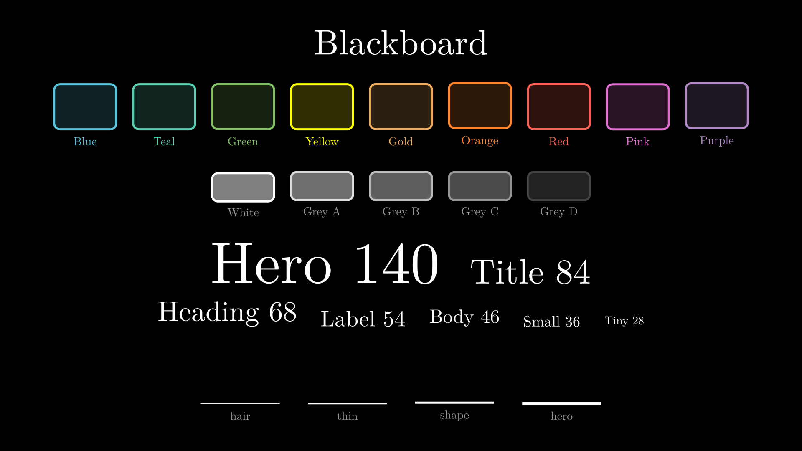
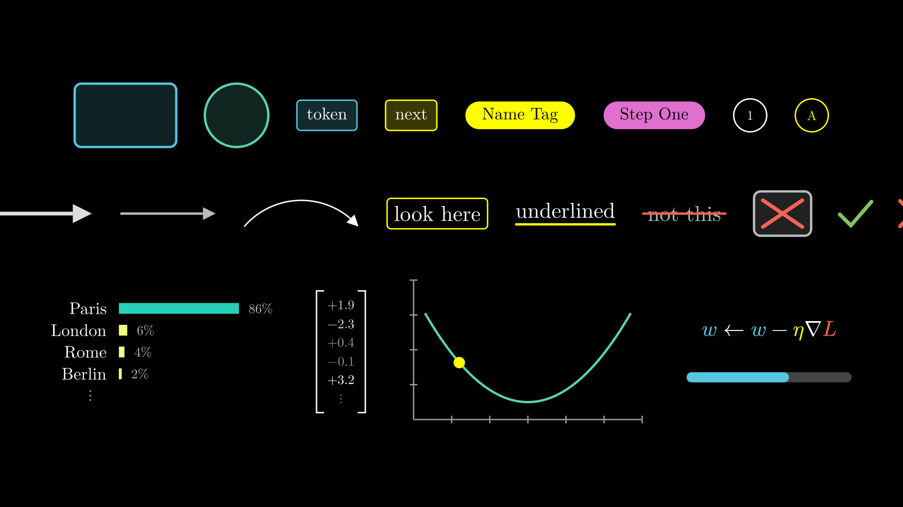
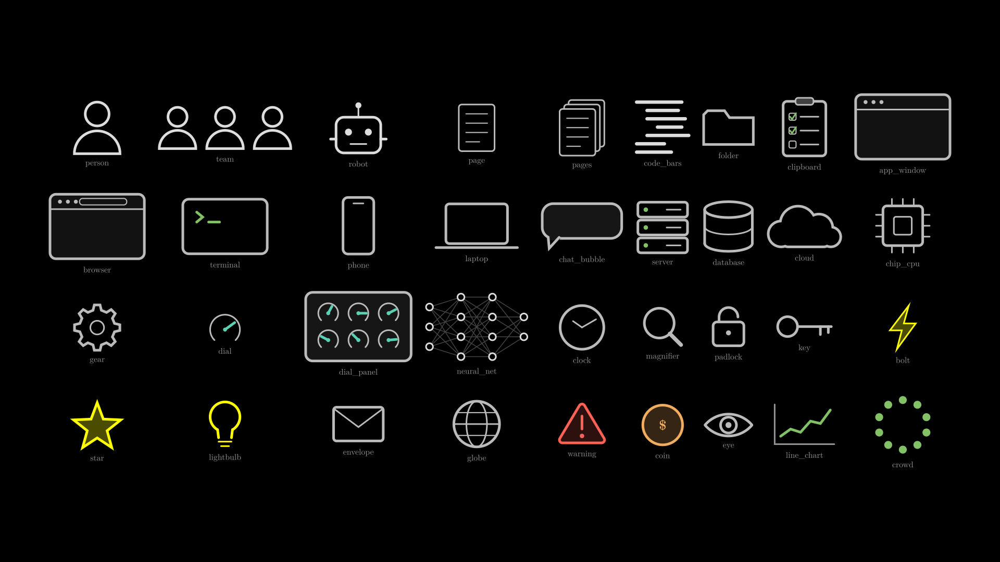

# STYLE.md: the look

The house style is called **Blackboard**. It is written in the tradition of 3Blue1Brown: a black
stage, Computer Modern type, colour as meaning, thin strokes, one second of smootherstep for every
move. Every value lives in [`theme/tokens.json`](theme/tokens.json) and
[`theme/backdrops.json`](theme/backdrops.json); both engines read those files, so nothing here is
ever typed into a scene. Where the values come from: [`docs/RESEARCH.md`](docs/RESEARCH.md). Rules
that came out of reviews live in [`FEEDBACK.md`](FEEDBACK.md) and override this file.

## In one breath

A black stage with a quiet field of dots. Everything is set in Computer Modern. White and grey draw
the structure; colour appears on strokes, words and small fills, and each colour means one thing for
the whole video. One central picture keeps turning into the next idea instead of the stage being
cleared. Labels are one to three words and arrive on the word that names them. Nothing bounces,
flashes or wiggles, and nothing sits still for long.

## Colour

| Token | Hex | Say it as | Default role |
|---|---|---|---|
| `bg` | `#000000` | black | The stage |
| `text` | `#FFFFFF` | white | Text, primary strokes |
| `grey.a` | `#DDDDDD` | light grey | Arrows |
| `grey.b` | `#BBBBBB` | grey | Outlines of neutral things (a model, a window, a page) |
| `grey.c` | `#959595` | mid grey | Secondary labels, inactive words, axes |
| `grey.d` | `#444444` | dark grey | Guides, empty slots, tracks. Never text |
| `blue` | `#58C4DD` | blue | **subject**: the thing being explained, the input |
| `blue_light` | `#9CDCEB` | light blue | Blue words (easier to read as text) |
| `teal` | `#5CD0B3` | teal | **process**: computation, flow, settings |
| `green` | `#83C167` | green | **right**: correct, working, done |
| `yellow` | `#FFFF00` | yellow | **focus**: the thing to look at, the answer, the reveal |
| `gold` | `#F0AC5F` | gold | **quantity**: numbers, cost, time |
| `orange` | `#FF862F` | orange | A spare accent |
| `red` | `#FC6255` | red | **wrong**: errors, breakage, "not this" |
| `pink` | `#E06FD0` | pink | **other**: a second concept set against the subject |
| `purple` | `#B189C6` | purple | A third concept; keywords in code |
| `ramp` | `#FFFF90` to `#25D1B8` | pale yellow to teal | A value from low to high (`ramp_color`) |

Rules:

- **A concept keeps its colour for the whole video.** Roles are fixed when the first section is
  planned and written in the video's `CONTINUITY.md`. The defaults above apply until then.
- **At most three accent colours in a frame.** Grey is not an accent.
- **Colour sits on strokes, words and small fills.** Large areas stay black or dark grey.
- **A shape with a role is a full-strength stroke plus a solid tint of the same hue** (`tint()`,
  18% over the stage). Solid, never translucent: a solid fill hides lines passing behind it.
- **Terms take the colour of the thing they name**, in equations and in code alike
  (`eq(..., colors=)`, `<Code roles=...>`).
- **Yellow is spent, not scattered**: one thing per frame.
- Every text colour holds a contrast of at least 4.5 on every backdrop (`./x contrast`).

## Type

Latin Modern, the OpenType Computer Modern: Roman for everything, Mono for code, Sans for interface
text inside a product mock. Both engines load the same files from `public/fonts/`.

| Token | Em at 1080p | Use |
|---|---|---|
| `hero` | 140 px | One number or symbol that is the picture |
| `title` | 84 px | A big readout; a single word as a headline (rare) |
| `heading` | 68 px | A number beside its label |
| `label` | 54 px | A name on or beside its object; code in an editor |
| `body` | 46 px | The default: words that are content, list rows, prompts |
| `small` | 36 px | Secondary tags, axis names |
| `tiny` | 28 px | Percentages, vector entries |
| `min` | 24 px | Nothing is smaller than this after any scale or camera move |

Rules:

- **Show the thing, then name it.** A label arrives after its object, on the word that names it.
- **Labels are 1 to 3 words.** No sentences, bullet lists, titles across the top or captions of
  what the voice says.
- **Text that is the subject is content, not captioning**: a prompt, a sentence being taken apart,
  a line of code, a list of guesses. Use as much of that as the idea needs.
- **About five words of labelling on screen at once.** Numbers, symbols and shapes beat words.
- Words that share a line share a baseline (`baseline_row`, `align_baseline`).

## Layout

- The canvas is 1920 x 1080; Manim's frame is 14.22 x 8 units, **135 px per unit**, origin at the
  centre. `px()` converts in both kits.
- **Safe area:** 96 px left and right, 72 px top and bottom. `check_layout()` enforces it.
- **One focal point per frame**, composed around the centre, with about a third of the frame empty.
- **The hero is large**: the main object takes a quarter to a half of the frame's height.
- **Nothing overlaps, ever**, not even mid-move, unless one thing deliberately contains the other
  (text on a card, a highlight around a row). Make room first, then enter. The overlap audit checks
  every tenth of a second of every Manim animation.
- Position by relation (`next_to`, `arrange`, `align_to`), with `GAP` (48 px) between an object and
  its label and `SPACE` (108 px) between siblings.
- Backdrop patterns sit on the half-unit lattice, so objects on whole and half units line up with
  the dots.

## Shapes

- Strokes: `hair` 1.5 px, `thin` 3 px, `shape` 5 px, `hero` 8 px, arrows 8 px.
- Pictograms are drawn from primitives: two to eight strokes at one weight, about one unit tall,
  light grey unless they carry a role. No SVG files, emoji, icon fonts, logos or photographs of
  real brands or people.
- A model is a box of dials (`dial_panel`); its dials are its numbers.
- Words in boxes are `token()` (thin coloured box, white text). A name tag is `chip()` (solid pill,
  dark text, Title Case).
- Arrows are thick and light grey with a big head; thin arrows inside dense diagrams.

## Motion

Everything eases with **smootherstep** (`6t^5 - 15t^4 + 10t^3`) over **1 second** unless the table
says otherwise. One move per kind of object, the same every time: repetition reads as authored,
variety for its own sake reads as generated.

| Object or intent | Move | Manim (`xkit`) | Remotion (`@kit`) |
|---|---|---|---|
| A word or short label | Writes on, glyph by glyph (outline, then fill), about 0.06 s a glyph | `write(m)` | `<Write at text />` |
| A label, number, mark | Fades in while rising a little | `rise(m)` | `<Enter kind="rise" at />` |
| A dot, chip, badge, small icon | Grows from 60% while fading in. No overshoot | `pop(m)` | `<Enter kind="pop" at />` |
| A line, curve, outline, pictogram | Draws on | `draw(m)` | SVG with `pathLength` (see `HighlightBox`) |
| A tinted shape | Outline draws, then the fill comes up | `build(m)` | `<Enter kind="fade" at />` |
| An arrow | Grows from its tail | `grow(a)` | `<Arrow progress />` |
| A list | Rows land top to bottom, 0.25 s each, 0.035 s apart | `pop_list(rows)` | `<Enter kind="slide" at={cascade(...)[i]} />` |
| A panel, a picture | Fades in | `fade_in(m)` | `<Enter kind="fade" at />` |
| One thing becomes another | Morphs over 1.5 s | `morph(a, b)` | (route the beat to Manim) |
| Something comes out of something | Copies out of its source | `from_copy(a, b)` | |
| A change of role | Stroke and tint change colour | `recolor(m, GREEN)` | colour as a function of `t` |
| Look here | Highlight box draws; or the word turns yellow; or everything else dims | `highlight_box`, `glow`, `dim` | `<HighlightBox progress />` |
| Not this | An X on a box; a line through a word | `strike`, `cross_out` | |
| A number that runs | Counts on a fixed baseline | `counter(self, tracker)` | `<Num value />` |
| A signal | A dot travels the path and is gone | `travel(path)` | |
| Text or code being typed | Appears a character at a time | | `typed()`, `<Code lineAt />` |
| A dive into a detail | The camera reframes, then comes back | `self.zoom_to(m)`, `self.zoom_out()` | |
| Leaving | Fades, shorter than it arrived (0.5 s) | `*leave(a, b)`, `sink`, `undraw` | `<Enter out />` |

Timing:

- Arrivals 0.4 to 0.8 s. Transforms that carry meaning 1.2 to 2 s. Groups 0.25 s an item.
- **A change lands on the word that causes it.** `on("word")` and `word("Beat", "word")` place
  moves; they start 0.12 s early so they land on the word.
- **Something meaningful changes at least every two seconds or so**, and no stretch stays still for
  more than 2.5 s. While the voice explains, the picture keeps making small, real changes: a signal
  travels an arrow, a value updates, the highlight steps on, the camera reframes onto the detail
  being named. Vary the kind of move from beat to beat.
- Things that happen together go in one `play`. Avoid a metronome: every move the same length with
  the same gap.
- **Frame 0 is already moving. The last frame is a clean composed still.**

Never used: `Flash`, `Wiggle`, `Indicate`, `FocusOn`, `ApplyWave`, `SpinInFromNothing`, bouncy or
overshooting easing, glows, particles, shaking, drifting cameras, idle pulsing or breathing.

## Backdrops

One backdrop for the whole of a section. With the default policy, `rotate`, the next section uses a
different one, chosen by what the section mostly shows. Never a warm or reddish background.

| ID | Looks like | Use for |
|---|---|---|
| `dots` | black with a field of dots | math, vectors, plots, concepts and metaphors, reveals |
| `ink` | deep blue-black, plain | narrative beats, prompts and sentences, people and stories |
| `grid` | navy with a faint grid | systems, architectures, pipelines, data flow |
| `graphite` | dark grey, plain | code, terminals, tools, step-by-step procedures |
| `black` | pure black, plain | 3D, dense math, anything a pattern would compete with |

Both engines paint the same PNG, so a cut between engines never moves the stage. Set
`"backdrop_policy": "fixed"` in a video's `video.json` to keep one backdrop for the whole video.

## Engine switches

A switch between Manim and Remotion is a hard cut at a beat boundary, where the picture changes
subject anyway. To keep it from reading as a seam:

- The incoming segment's opening picture is on stage from its first frame. A cut never lands on
  an empty stage.
- Type, colours, stroke weights and the backdrop are identical on both sides (`./x parity`).
- A colour role survives the cut: what was red before it is red after it.
- When the same object appears on both sides, give it the same place and size (`px()` converts
  Manim coordinates to canvas pixels).

## What reads as AI-generated (avoid all of it)

- Library default colours or fonts; a rainbow of accents.
- Text doing the explaining: titles, bullet lists, captions of the narration, words in boxes as the
  main visual.
- Every object entering a different way; flashes, wiggles, spins and bounces.
- Constant aimless motion, or a frame that never changes.
- Clearing the stage between beats instead of turning one idea into the next.
- Collage frames: several unrelated diagrams at once, no focal point, labels crowding shapes.
- Glows, gradients on everything, drop shadows, particle fields.
- A metronome rhythm.

## Changing the style

Edit `theme/tokens.json` (and `theme/backdrops.json`), then run `./x contrast`, `./x specimens`
and `./x parity`. To add a second style, give it its own token file and load it by name; scenes
should keep importing names (`BLUE`, `BODY`, `P.blue`, `TYPE.body`), never values.
